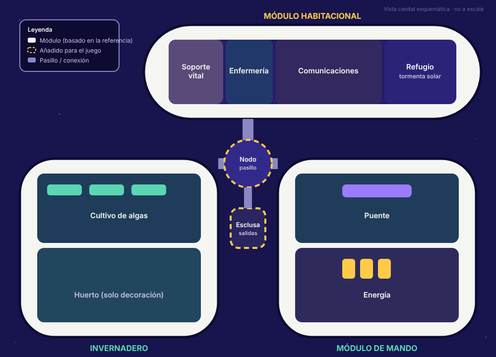

# Escenario: Estación Central (v2)

Puesto avanzado **en la superficie lunar** donde ocurre el juego. Esta versión sigue el *Diseño detallado v2* y deja **solo lo esencial**: 8 salas, una por cada acción del juego. Todo lo demás es decoración, sin acción ni efecto.

> Cambios respecto a la v1: la base pasa de la órbita a la superficie. Se eliminan las salas sin acción en el diseño v2 (baño, laboratorio, cultivos 2 y 3) y se agregan Puente y Energía en el módulo de mando. El costo de cada acción viene de la tabla del diseño v2.

## Archivos

| Archivo / carpeta | Qué es |
|---|---|
| `ESCENARIO.md` | Este documento. |
| `estacion-central.json` | Datos de las salas: acción, efecto, costo, objeto interactivo, decoración y conexiones. |
| `layout-salas.json` | Posición de cada objeto en cada sala, para que el motor los dibuje como sprites independientes. |
| `plano.svg` / `plano.png` | Plano esquemático propio. |
| `assets/interactivos/` | Los 8 objetos con acción, **cada uno por separado** (SVG + PNG @2x con borde de papel). |
| `assets/decoracion/` | Objetos decorativos por separado. |
| `assets/cascaron/` | Piezas de pared: ventana en tres estados (día, atardecer, noche) y puerta lateral. |
| `assets/props.json` | Catálogo: tipo, colocación (piso o pared), tamaño y ancla de cada asset. |
| `fondos/<sala>/fondo-vacio` | La sala sin objetos: piso en perspectiva, pared y techo curvo. |
| `fondos/<sala>/fondo-compuesto` | Vista previa de la sala armada con los assets. El Puente trae las tres variantes del calendario. |
| `referencia/` | Imagen original de Lunar Palace 1, solo para uso interno. |

**Orden de producción (regla del equipo):** primero se genera cada asset por separado; después se coloca en el fondo. En el juego, el motor dibuja el `fondo-vacio` y encima cada objeto como un sprite propio, ordenado por profundidad. Así el michi puede pasar por delante o por detrás de los objetos. El `fondo-compuesto` sirve solo como referencia visual.

---

## 1. Distribución

Se mantiene la silueta de la referencia (Lunar Palace 1: un módulo largo y dos cilindros), con otro uso para cada sala:

| Módulo | Sala | Viene de (referencia) | Acción del diseño v2 | Efecto | Costo |
|---|---|---|---|---|---|
| Habitacional | **Refugio** | Dormitorio | Blindaje activo | Radiación ×0,1 | −8 Energía y no se hace nada más |
| Habitacional | **Enfermería** | Baño | Curar | +25 Salud | −4 Energía |
| Habitacional | **Comunicaciones** | Comedor y comunicaciones | Alinear antena | Enlace 100 % | −5 Energía |
| Habitacional | **Soporte vital** | Reciclaje de residuos | Reciclar aire | +15 Oxígeno | −6 Energía |
| Invernadero | **Cultivo de algas** | Sala de cultivo 1 | Encender luces de cultivo | +10 Comida, +4 Oxígeno al cierre | −7 Energía |
| Mando | **Puente** | Cabina de vegetación 2 | Pronóstico y diagnóstico | Ve eventos de las 2 jornadas siguientes y el estado de los componentes | −1 Energía |
| Mando | **Energía** | Cabina de vegetación 2 | Orientar paneles / limpiar polvo | +20 Energía (×0,5 al atardecer, 0 de noche) / recupera rendimiento | +5 Radiación / tiempo |
| Nodo | **Esclusa** | Añadida | Salida al exterior (minijuego de 60 s) | Ciencia o reparación | Oxígeno y Energía |

**Consumo pasivo por jornada:** Energía −8, Oxígeno −12, Comida −10. Batería con tope 100.

**Conexiones:** Refugio ↔ Enfermería ↔ Comunicaciones ↔ Soporte vital · Comunicaciones ↔ Esclusa · Esclusa ↔ Cultivo · Esclusa ↔ Puente ↔ Energía.

La Esclusa queda en el centro como cruce obligado, y el Refugio en un extremo. Ir a protegerse de una tormenta solar **cuesta camino**, y eso también es parte del trade-off.

---

## 2. Qué es esencial y qué es decoración

| Sala | Objeto con acción | Decoración (sin acción) |
|---|---|---|
| Refugio | `refugio-capsula`: cápsula con paredes de agua y banda de blindaje | casillero, planta |
| Enfermería | `camilla-medica`: camilla con monitor | cuadro de la Tierra, extintor |
| Comunicaciones | `consola-antena`: consola de radio con plato | mesa del comedor (recuerdo del comedor de la referencia), cajas |
| Soporte vital | `reciclador-aire`: tanque con ventilador y O₂ | cajas, extintor |
| Cultivo de algas | `tanque-algas`: tanque verde con lámpara de cultivo | 2 bandejas de huerto (la sala de cultivo 2 de la referencia), planta |
| Puente | `consola-puente`: consola de mando con pronóstico | casillero, cuadro de la Tierra |
| Energía | `banco-baterias`: 3 baterías con nivel visible | cajas |
| Esclusa | `puerta-esclusa`: compuerta redonda al exterior | casillero de trajes |

**Reglas de la decoración:**
- No se le puede hacer clic y no cambia ningún recurso.
- Debe verse un poco menos llamativa que el objeto interactivo. El interactivo va al centro de la sala y se resalta en dorado cuando el michi está cerca.
- Se puede reemplazar o quitar sin tocar la lógica del juego.

---

## 3. El calendario lunar en el escenario

La **ventana** es una pieza aparte con tres estados que el motor cambia según la jornada:

| Jornadas | Luz | Ventana |
|---|---|---|
| 1–3 | 100 % | `ventana-dia`: Sol alto, suelo lunar claro |
| 4 | 50 % | `ventana-atardecer`: Sol en el horizonte, suelo más oscuro |
| 5–7 | 0 % | `ventana-noche`: sin Sol, suelo oscuro, solo la Tierra y las estrellas |

Así el niño **ve** por qué los paneles rinden menos sin tener que leer un número. En el Puente está la ventana principal, y el cambio se nota más ahí.

---

## 4. Cómo se arma una sala (motor)

1. Dibujar `fondos/<sala>/fondo-vacio@2x.png` (1920×1200; se muestra a 960×600).
2. Colocar las piezas de pared (puertas con el nombre de la sala de destino, ventana según la jornada, cuadros y compuerta) en las coordenadas `pared_x` y `pared_y` de `layout-salas.json`.
3. Colocar los objetos de piso en `(x, z)` con la misma proyección del prototipo 2.5D:
   - `x` va de 0 a 12 (izquierda a derecha) y `z` de 0 a 6 (fondo a frente).
   - `pantalla_y = 250 + 310 · z/6` y `escala = 0,72 + 0,40 · z/6`, multiplicada por la `escala_base`.
   - Ancla en el centro inferior y sombra elíptica en el piso.
4. Ordenar los objetos y al michi por `z` en cada frame.
5. El objeto interactivo muestra **USAR (E)** cuando el michi está a menos de 1,5 unidades.

---

## 5. Datos reales asociados a cada sala

| Sala | Dato NASA (según el diseño v2) |
|---|---|
| Puente | Pronóstico con llamaradas reales de **DONKI** (fecha real de cada jornada). |
| Refugio | Radiación en mSv, con la línea base de la ISS (**RadLab**). La cifra de superficie lunar está pendiente de verificar. |
| Enfermería | Ficha real de salud espacial (**OSDR**), por ejemplo sobre pérdida ósea. |
| Comunicaciones | Demora real a la Luna (~1,3 s por sentido) comparada con la de Marte. |

Cada dato lleva su atribución dentro del juego e indica si es en vivo o archivado.

---

## 6. Referencia

La distribución se inspira en **Lunar Palace 1 (Yuegong-1)**, un laboratorio terrestre de soporte vital biorregenerativo de la Universidad de Beihang. Tiene dos cabinas de plantas y una cabina integral (unos 160 m²), y su experimento de 370 días alcanzó un 98 % de autosuficiencia. En el juego es una base **ficticia**: no se usan el nombre, los logos ni la imagen de la instalación real.

Fuentes: [Beihang University](https://ev.buaa.edu.cn/info/1107/2651.htm) · [Space.com](https://www.space.com/40612-china-lunar-palace-1-mock-moon-mission.html) · [bioRxiv (2021)](https://www.biorxiv.org/content/10.1101/2021.01.12.426282v1.full-text)
